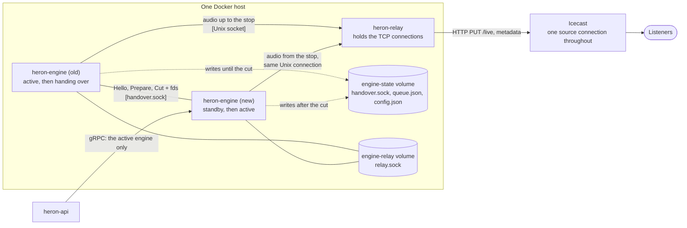
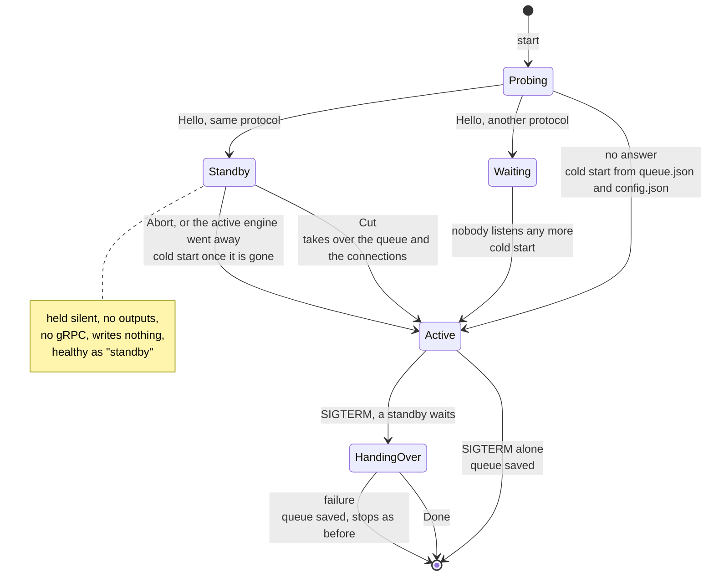
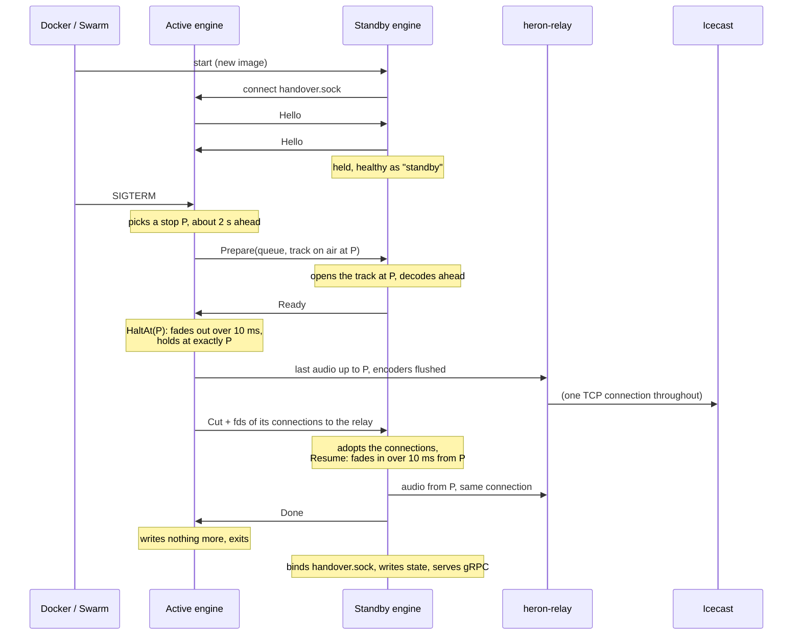
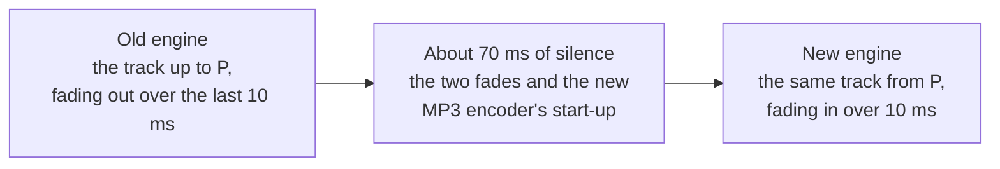

# Engine handover

How a new `heron-engine` takes over from the running one without taking the station off air: the design behind [Audio engine – Upgrades and handover](audio-engine.md#upgrades-and-handover), for whoever works on it. The procedures that use it are in [Upgrading](upgrading.md). Built in [M8](roadmap/m8-hot-engine-upgrade.md).

## The problem

Restarting the engine is safe for the programme since [M3](roadmap/m3-reliability.md): the queue is saved on SIGTERM and the next engine resumes the track on air where it was. It is not safe for the listeners. Between the old engine's exit and the new one's first byte, Icecast has no source on the mount and disconnects every listener, and many players never reconnect.

The fix has to keep **one source connection** open on Icecast from the old engine to the new one, and make the audio carry on from the exact sample where the old engine stopped.

## The idea

Run both engines side by side for a few seconds. The new one (the **standby**) prepares everything that takes time: it reads the track on air, seeks into it, and builds its encoders. Then the old one (the **active** engine) stops at an agreed sample and hands its open connections to the standby, which goes on writing to them. A Unix process can give another process an open file descriptor over a Unix socket (`SCM_RIGHTS`), so Icecast sees the same connection carry on: no new `PUT`, no listener moved.

### Why the connections go through a relay

A TCP socket belongs to the network namespace of the process that opened it. Two containers have two namespaces, and Docker deletes a container's network interface when it stops. A TCP socket passed from the old engine's container to the new one keeps working only until the old container stops; then its packets have nowhere to go. (Seen in a first version: 2 s after the handover the stream stalled, Icecast dropped the source after its timeout, and the new engine had to reconnect.)

So the TCP connections to stream servers are held by a third, long-lived process: **`heron-relay`** (`heron-engine relay`, same image). An engine connects to it through a Unix socket in a volume they share, asks for `CONNECT host:port`, and the relay opens the TCP connection from its own container and carries bytes both ways. The engine hands over its **Unix** connection to the relay: Unix sockets do not depend on a network namespace, so the new engine keeps writing to it after the old container is gone, and the relay's TCP connection to Icecast never changes.

The relay only carries bytes: no audio, no encoding, no configuration. It almost never needs changing, so `scripts/upgrade.sh` leaves it running. Restarting it is a short break, like an engine restart, covered by the fallback mount. While it is down, the engine connects directly (and then hands over a TCP connection, which works only when both engines share a network, as in the tests).

Alternatives considered:

| Option | Why not |
|---|---|
| A streaming service doing the encoding and holding the connections, fed PCM by the engine | Its own upgrades would still drop the listeners, and it would change as often as the encoders. The relay chosen instead only carries bytes, so it is upgraded almost never. |
| Both engines in one network namespace (a container holding it, `network_mode: service:`) | Not available in Docker Swarm; the two engines would also share their HTTP and gRPC ports. |
| Two Icecast mounts and `fallback-override`, the new engine on the other mount | Icecast only (not HLS or Shoutcast), the mount names alternate between upgrades, and listeners are moved, not kept. |
| Start the new engine first and let it connect when the old one leaves | A gap of a few seconds anyway (backoff after `403 mount in use`), and two engines writing `queue.json`. |

The Icecast fallback mount ([Upgrading](upgrading.md#icecast-fallback-mount)) is still needed for the restarts that are not handovers: a crash, a reboot, an incompatible version.

### During an upgrade

For a few seconds, two engines run side by side on the same host. Everything that must survive the swap lives outside both: the state and `handover.sock` in `engine-state`, the TCP connection to Icecast in `heron-relay`.

## Pieces

| Where | What |
|---|---|
| `crates/engine/src/handover.rs` | The socket, the messages, the active side (`Listener`, `hand_over`) and the standby side (`probe`, `follow`) |
| `crates/engine/src/main.rs` | Startup (probe → cold start, or standby → take over or cold start) and shutdown (hand over if a standby is connected) |
| `crates/engine/src/engine.rs` | `prepare_takeover`, `complete_takeover`, `cold_start` (standby); `handover_point`, `halt_at`, `release_outputs`, `stop_saving` (active) |
| `crates/engine/src/player.rs` | `hold` / `unhold`, `handover_point`, `halt_at`, `take_over` (the queue at an exact position), `handed_over` (the queue to send) |
| `crates/engine/src/mixer.rs` | `Command::Hold`, `Command::HaltAt` and `Event::Halted`; `MixerStatus::cued_ready` |
| `crates/outputs/src/pipeline.rs` | `Outputs::stop_after` (no audio after a frame), `Outputs::release` (flush, then give up the connections), `Outputs::apply_adopting` |
| `crates/outputs/src/sink.rs`, `icecast.rs` | `OutputSink::take_connection`, the release request in `sink::run`, `IcecastSink::adopt` |
| `crates/outputs/src/connection.rs` | `Connection` (TCP, or relayed through a Unix socket), handing it over and adopting it, and the relay itself (`serve_relay`) |
| `crates/outputs/src/encoder.rs` | `Encoder::flush` |

## Roles and the socket

The active engine listens on `$HERON_STATE_DIR/handover.sock`. It binds it under another name and renames it over the path, so an engine taking over replaces its predecessor's socket atomically, while that one is still running.

On start, an engine connects to that socket, and goes through these roles:

Each side sends `Hello { protocol, version }`. The active engine keeps a standby only if it speaks the same `PROTOCOL` (`handover.rs`). Bump it whenever a message changes in a way an older engine cannot read.

A standby **owns no state**. It does not read `queue.json` or `config.json`, writes neither (the engine's `closing` flag is set from the start), and does not serve gRPC: calls from `heron-api` that reach it (the `heron-engine` name points to both engines during the overlap) fail as unavailable and are retried. `/healthz` succeeds with `"role": "standby"`, so Docker's health check and Swarm's `start-first` update treat it as started. Its audio thread runs, held silent.

## Messages

Length-prefixed JSON: a 4-byte big-endian length, then the message. A message is sent with one `sendmsg`; file descriptors travel as ancillary data on its first byte, and are received with the 4-byte header.

| Message | Direction | Meaning |
|---|---|---|
| `Hello { protocol, version }` | both | First message each way |
| `Prepare { attempt, config, queue }` | active → standby | Get ready to go on with this queue (the `queue.json` format), the track on air stopping at `queue.on_air.position_ms`. A later `Prepare` replaces it. |
| `Ready { attempt }` | standby → active | The track on air is open at that position, with enough audio decoded |
| `Cut { outputs }` | active → standby | Stopped. The connections of `outputs` (output ID and kind: `relayed` or `tcp`) come with it, in that order |
| `Done` | standby → active | On air |
| `Abort { reason }` | active → standby | The handover is given up |

## Sequence

## Choosing where to stop

`Player::handover_point(lead_ms)` answers:

- **Now**: paused, held, or nothing on air. The active engine holds the mixer at once (`Command::Hold`), so nothing starts while the standby prepares, and sends the queue as it is.
- **At { position }**: the track on air stops at `position`, `lead_ms` from its current position, rounded to a millisecond (saved queues count in milliseconds; the decoder seeks to a millisecond, so both engines agree on the frame).
- **Wait**: the FX player is playing, two decks are playing (a transition), or the stop would be less than 1 s before the next transition (the cued track's planned start, or 15 s before the end of the track when nothing is cued yet, since a fallback track may be cued with a transition then). The active engine asks again every 10 ms, within the time limit.

So the cut never falls in a crossfade or under a jingle: there is a single voice to stop and to resume.

## Getting ready, and retries

The standby resets its player, then `Player::take_over` cues the track on air starting at the stop position (the same fast skip as a restart, without its own fade-in), and queues the waiting tracks. The mixer is held, so the cued track does not start. The standby polls `MixerStatus::cued_ready` (the decoder has `READY_SAMPLES` decoded) and answers `Ready`.

The active engine needs `Ready` at least 300 ms (`READY_MARGIN`) before the track reaches the stop, to plan the stop in time. Seeking far into a long file on a Raspberry Pi can take longer than the 2 s lead, so a late `Ready` is not an error: the active engine sends a new `Prepare` with a lead three times longer (2 s, 6 s, 18 s), and ignores a `Ready` for an earlier attempt. After three attempts, or 25 s in all (within the 30 s stop grace period), it gives up.

## Stopping on the exact frame

`Command::HaltAt { position }` is handled on the audio thread:

- It sets a 10 ms linear fade-out on the track on air, ending at `position`.
- `next_segment` ends a segment exactly at `position`, so the render loop lands on it. There the mixer holds: paused, gain 0, frozen. The rest of the block is silence, and `Event::Halted { position, at_frame }` reports the master frame.
- `Resume` removes the halt's fade, in case the handover is given up and the engine plays on.

What the listeners hear around the stop P:

The outputs must not carry the silence that follows. `Outputs::stop_after(at_frame)` makes the fan-out thread hand nothing to the encoders after that master frame (it counts the frames it reads, which match the frames rendered unless blocks were dropped). The active engine waits 100 ms for the audio rendered ahead (the clock renders 50 ms ahead) to reach the encoders.

## Handing over the connections

`Outputs::release` stops in this order, so no audio is lost and no connection is closed:

1. Each encoder thread encodes what it was given, flushes its encoder (`Encoder::flush`: for MP3, LAME's last frames) and ends. Its broadcast stream stays open: an output that saw it end would disconnect.
2. Each output task gets a release request. It sends what is already encoded, then `take_connection` gives its socket back instead of closing it. An output that was not connected answers `None` and simply restarts in the new engine.
3. The active engine collects the sockets (2 s at most per output), sets `closing` (no more saves), and sends `Cut { outputs }` with the descriptors.

The standby turns each descriptor back into a connection of its kind, calls `Outputs::apply_adopting` (an `IcecastSink` built with `adopt` takes the connection on its first `connect`, without a request), then `unhold`: `Resume` fades in over 10 ms from the stop. The new encoders start from scratch. An MP3 stream is a sequence of independent frames, so players carry on. An Ogg stream will need a new chained stream (M11).

Measured: **70 to 90 ms** of silence in the stream at the cut in the tests below, 68 ms through Docker Compose and 72 ms through Docker Swarm with real containers, made of the two fades and the MP3 encoder's start-up delay. The time between the old engine's last byte and the new engine's first byte comes out of the players' buffers: it is never heard.

## The state

Exactly one engine writes the state at any time:

- The active engine writes until it sends `Cut`, then never again (`stop_saving`).
- The standby writes nothing until it is on air: `complete_takeover` or `cold_start` clears `closing`, saves the queue and the configuration, and only then does `main.rs` bind `handover.sock` and serve gRPC.

The track on air keeps its entry ID and is not reported as a new play. `heron-api` sees a new engine (another `engine_started_at`) and matches the track on air to its open play, as after a restart, so the history has one entry. It matches by track and start time, not by deck: a new engine starts with an empty mixer, so it plays the track on deck A even when it was on deck B (the row keeps the deck the track started on). A fallback track on air is handed over too (`SavedTrack::fallback`), although it is never saved on disk.

## Failures

The rule: whatever fails, it ends as a cold restart covered by the fallback mount, never worse than without a handover.

| Failure | Active engine | Standby |
|---|---|---|
| The standby dies, or its socket closes | `hand_over` fails; stops as before (saves the queue) | Gone |
| Not ready after three attempts | Sends `Abort`, stops as before | Waits until the active engine is gone, then cold start |
| The track on air does not stop (2 s) | Plays on (`unhold`), sends `Abort`, stops as before | Cold start |
| An output gives no connection | Hands over the others | Connects that output itself |
| The active engine dies before `Cut` | Gone (queue saved last, up to 5 s earlier) | Socket closed: cold start once nobody listens |
| The active engine dies after `Cut` | Gone | On air already |
| Incompatible protocol | Keeps no standby; stops as before when asked | Waits, then cold start |
| SIGTERM to the standby | Not affected | Exits without touching the state |
| The relay is down | Connects directly; its TCP connections are handed over, and die when the old container stops: the new engine reconnects (fallback mount) | Same |
| The relay restarts | Its connections end: the outputs reconnect, through the relay once it is back | — |

## Orchestration

The protocol needs the new engine started while the old one runs, on the same host, with the same state volume and the relay's socket volume, and then SIGTERM to the old one.

- **Docker Swarm**: `update_config.order: start-first` does exactly that: Swarm starts the new task, waits until it is healthy (a standby is), then stops the old one.
- **Docker Compose** has no `start-first`. `scripts/upgrade.sh` scales `heron-engine` to two containers without recreating the old one, waits for the new one's health, then stops and removes the old one.

`stop_grace_period: 30s` gives the handover its time. With a plain `docker compose up -d`, Compose stops the old engine first: there is no standby, so it is a cold restart.

## Tests

`crates/engine/tests/handover.rs` runs two real engines on one state directory against a fake Icecast server:

- **hands over the queue and the connection**, directly and **through the relay**: one source connection throughout, never closed; the same track on air with the same entry ID and the same waiting tracks; audio keeps coming; the longest silence in the received stream, from the hand-over on, is under 200 ms (before it, the stream starts with a silence until the first track loads, longer on a busy machine).
- `crates/outputs/src/connection.rs`: the relay carries bytes both ways, a relayed connection keeps working after being handed over and adopted, and closing it closes the server's side.
- **plays on when the standby goes away**: the handover fails and the active engine is still on air, not held.
- **refuses a standby of another protocol**.

`scripts/chaos-test.sh` runs an upgrade on a Compose stack while listening to the stream.
